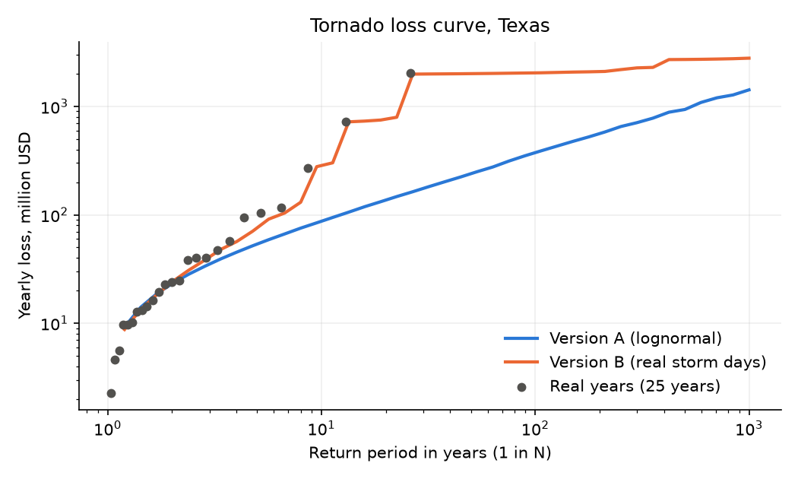

# Storm loss model

A small personal project on public data. I took NOAA records of tornado damage in Texas (2000 to 2024) and built a simple model that answers two questions: how much damage does an average year bring, and how bad is a 1-in-100 year?

The data is the NOAA Storm Events Database. The model is simple on purpose and is not an insurance catastrophe model: it has no buildings, policies or insurance terms, only reported damage. Dollar values are not adjusted for inflation.

## How it works

1. Count how many damaging storm days happen in a year.
2. Look at how big the damage of one storm day is.
3. Play out 100,000 made-up years using both parts, and add up the damage in each year.
4. Read the average year and the 1-in-100 year from those results.

I ran two versions of step 2. Version A fits a lognormal curve to the damage per storm day. Version B draws real storm days from the history.

## Results

After cleaning there are 533 storm days with damage above zero over 25 years, about 21 per year. Together they caused $3.76 billion of reported damage.

The number of storm days varies more from year to year than a Poisson count would (mean 21.3, variance 37.7), so I used a negative binomial for the frequency. The lognormal fit for the damage per storm day gives mu = 11.79 and sigma = 2.35.

All values in million USD:

| | Average year | 1 in 10 | 1 in 50 | 1 in 100 | 1 in 200 |
|---|---|---|---|---|---|
| Real history (25 years) | 150 | | | | |
| Version A, lognormal | 45 | 87 | 240 | 374 | 563 |
| Version B, real storm days | 150 | 283 | 2,006 | 2,038 | 2,097 |

The full table with all return periods is in `results/loss_summary.csv`.



The dots are the 25 real years. Both versions follow them closely up to about a 1-in-5 year. After that they split a lot.

### One storm day drives the result

The 20 October 2019 storm day caused $1.98 billion, which is 53% of all damage in the data. The next biggest is $717 million (3 April 2012). Because of this, the real average year ($150 million) is mostly one event, and the 1-in-100 value of version B is just that same event repeated, so it should not be read as a real estimate. Version A fits the typical storm day and gives a much lower average ($45 million), so it probably misses the extreme tail. The truth is likely somewhere between the two, and 25 years cannot say where.

### Sensitivity

I changed one assumption at a time and kept everything else fixed (version A, `results/sensitivity.csv`):

| Case | Average year | 1 in 100 | Change in 1 in 100 |
|---|---|---|---|
| Base case | 45.2 | 373.6 | |
| 20% fewer storm days | 36.0 | 315.3 | -15.6% |
| 20% more storm days | 54.7 | 426.5 | +14.1% |
| Damage per storm day 20% lower | 36.2 | 298.9 | -20.0% |
| Damage per storm day 20% higher | 54.3 | 448.4 | +20.0% |


The damage per storm day moves the 1-in-100 loss a bit more than the number of storm days.

### Simulation size

I repeated the 1-in-100 estimate with different random seeds to see how much it moves (million USD):

| Simulated years | Lowest | Highest |
|---|---|---|
| 1,000 | 281 | 411 |
| 10,000 | 334 | 368 |
| 100,000 | 351 | 370 |

With 1,000 years the answer is unreliable. At 100,000 it stays within about 5%, which is why I use that size.

## Dashboard

`app.py` is a small Streamlit dashboard on the same model. The sidebar has two sliders that scale the number of storm days and the damage per storm day against the history, and a switch between the lognormal curve and real storm days. The average year, the 1-in-100 year and the loss curve update when I move them. The history table at the bottom shows storm days and damage per year.

```
streamlit run app.py
```


The dashboard runs fewer simulated years than the scripts so it responds quickly, so its numbers differ slightly from the table above ($44.9M and $360M against $45.2M and $374M).

## Run it

Step 3 needs a local PostgreSQL server. Host, port and user are set in `config.py`. If the server asks for a password, set it in the environment variable `PGPASSWORD`. The script creates the database `storm_loss` itself.

```
pip install -r requirements.txt
python 01_download_data.py
python 02_clean_data.py
python 03_sql_check.py
python 04_fit_model.py
python 05_simulate_and_curve.py
python 06_sensitivity.py
streamlit run app.py
```

The peril, state and years are set in `config.py`.

## Files

| File | What it does |
|---|---|
| `config.py` | Settings |
| `01_download_data.py` | Downloads the yearly NOAA files |
| `02_clean_data.py` | Keeps one peril and one state, builds storm days |
| `03_sql_check.py` | Loads the storm days into PostgreSQL, runs the SQL files, checks the yearly totals against pandas |
| `sql/create_table.sql` | Creates the table |
| `sql/yearly_totals.sql` | Storm days and damage per year |
| `sql/top_storm_days.sql` | The ten biggest storm days and their share of all damage |
| `model_functions.py` | Functions the other scripts share |
| `04_fit_model.py` | Fits the frequency and damage parts to the history |
| `05_simulate_and_curve.py` | Simulates years with two model versions, draws the loss curve |
| `06_sensitivity.py` | Changes assumptions one at a time, checks the simulation size |
| `app.py` | Streamlit dashboard with sliders |
| `results/` | Output tables and the charts and dashboard screenshot shown above |

## Limits

- Only records with damage above zero are used. NOAA leaves damage empty or zero for many records, so the model describes reported damage.
- Twenty-five years of history cannot show a 1-in-100 year. That number comes from the fitted curve, not from the data.
- One storm day (October 2019) makes up over half of all damage, so the average and the tail depend heavily on a single event.
- Version B can never produce a storm day bigger than the biggest one in the history, so its tail is capped.
- Damage is reported in the dollars of the year it happened.
- Records for one storm are added up per day, so two storms on one day count as one storm day.
