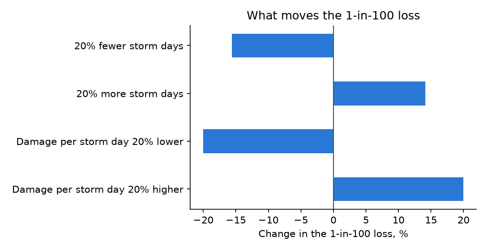
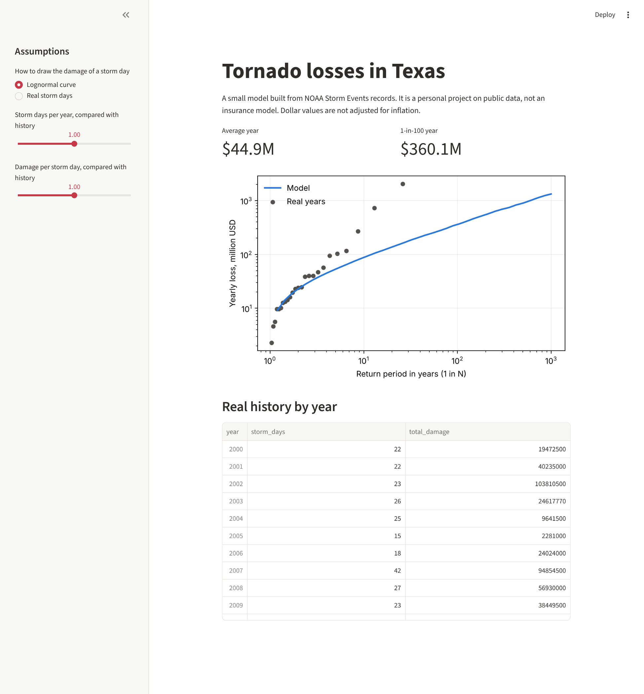

# Storm loss model

A small personal project on public data. I took NOAA records of tornado damage in Texas (2000 to 2024) and built a simple model that answers two questions: how much damage does an average year bring, and how bad is a 1-in-100 year?

The data is the NOAA Storm Events Database. The model is simple on purpose and is not an insurance catastrophe model: it has no buildings, policies or insurance terms, only reported damage. Dollar values are not adjusted for inflation.

## How it works

1. Count how many damaging storm days happen in a year.
2. Look at how big the damage of one storm day is.
3. Play out 100,000 made-up years using both parts, and add up the damage in each year.
4. Read the average year and the 1-in-100 year from those results.

I ran two versions of step 2. Version A fits a lognormal curve to the damage per storm day. Version B draws real storm days from the history.

## Results

After cleaning there are 533 storm days with damage above zero over 25 years, about 21 per year. Together they caused $3.76 billion of reported damage.

The number of storm days varies more from year to year than a Poisson count would (mean 21.3, variance 37.7), so I used a negative binomial for the frequency. The lognormal fit for the damage per storm day gives mu = 11.79 and sigma = 2.35.

All values in million USD:

| | Average year | 1 in 10 | 1 in 50 | 1 in 100 | 1 in 200 |
|---|---|---|---|---|---|
| Real history (25 years) | 150 | | | | |
| Version A, lognormal | 45 | 87 | 240 | 374 | 563 |
| Version B, real storm days | 150 | 283 | 2,006 | 2,038 | 2,097 |

The full table with all return periods is in `results/loss_summary.csv`.


The dots are the 25 real years. Both versions follow them closely up to about a 1-in-5 year. After that they split a lot.

### One storm day drives the result

The 20 October 2019 storm day caused $1.98 billion, which is 53% of all damage in the data. The next biggest is $717 million (3 April 2012). Because of this, the real average year ($150 million) is mostly one event, and the 1-in-100 value of version B is just that same event repeated, so it should not be read as a real estimate. Version A fits the typical storm day and gives a much lower average ($45 million), so it probably misses the extreme tail. The truth is likely somewhere between the two, and 25 years cannot say where.

### Sensitivity

I changed one assumption at a time and kept everything else fixed (version A, `results/sensitivity.csv`):

| Case | Average year | 1 in 100 | Change in 1 in 100 |
|---|---|---|---|
| Base case | 45.2 | 373.6 | |
| 20% fewer storm days | 36.0 | 315.3 | -15.6% |
| 20% more storm days | 54.7 | 426.5 | +14.1% |
| Damage per storm day 20% lower | 36.2 | 298.9 | -20.0% |
| Damage per storm day 20% higher | 54.3 | 448.4 | +20.0% |



The damage per storm day moves the 1-in-100 loss a bit more than the number of storm days.

### Simulation size

I repeated the 1-in-100 estimate with different random seeds to see how much it moves (million USD):

| Simulated years | Lowest | Highest |
|---|---|---|
| 1,000 | 281 | 411 |
| 10,000 | 334 | 368 |
| 100,000 | 351 | 370 |

With 1,000 years the answer is unreliable. At 100,000 it stays within about 5%, which is why I use that size.

## Dashboard

`app.py` is a small Streamlit dashboard on the same model. The sidebar has two sliders that scale the number of storm days and the damage per storm day against the history, and a switch between the lognormal curve and real storm days. The average year, the 1-in-100 year and the loss curve update when I move them. The history table at the bottom shows storm days and damage per year.

```
streamlit run app.py
```



The dashboard runs fewer simulated years than the scripts so it responds quickly, so its numbers differ slightly from the table above ($44.9M and $360M against $45.2M and $374M).

## Language model part: reading the reports

Every NOAA record also has a short written report (the narrative), for example "roofs torn off two mobile homes, power lines down". I wanted to see how well a small language model reads these texts, and what the texts say beyond the damage number.

The model is Llama 3.2 3B, run on my own Mac through Ollama, so it is free and no text leaves the computer. Anyone can rerun it.

### Reading the reports (steps 7 to 9)

The model reads 500 reports and answers three questions from the text only: was anyone injured, was anyone killed, and which EF rating is written in the text. NOAA also records injuries, deaths and the rating as numbers, so I compare the model's answers with those numbers instead of labelling the reports myself. Injuries are rare (about 6% of records), so the sample holds every record with an injury and random other records up to 500. Ollama forces each reply into the same three fields, and the temperature is 0, so a rerun gives the same answers. Every disagreement is listed in `results/llm_disagreements_v1.csv` and `_v2.csv`.

There are two prompt versions, both kept in `08_llm_read_reports.py`. With the first, the model said "injured" far more often than NOAA. I read 15 of those false alarms, picked at random (`results/false_alarm_check.csv`, with my notes): none of them mentions a person, and about half mention damage to homes or buildings. The second prompt says that damage alone does not mean anyone was injured, and that road names such as F.M. 1536 are not ratings. Fifteen was enough here, because 14 of them showed the same mistake; reading more would only narrow the share, not change what the mistake is. The number is `N_FALSE_ALARMS_TO_READ` in `config.py`. Changing it, or deleting `false_alarm_check.csv`, makes step 9 (with prompt version 1) pick a new random set, so the notes have to be written again. `PROMPT_VERSION` in `config.py` picks the version, and the results of each version are saved with `_v1` or `_v2` in the file name.

Results on the same 500 reports (`results/llm_prompt_comparison.csv` and `results/llm_injury_text_check_v1.csv` / `_v2.csv`):

| | Prompt 1 | Prompt 2 |
|---|---|---|
| Injured: model says yes | 281 | 130 |
| Injured: precision (yes answers that NOAA confirms) | 63.0% | 98.5% |
| Injured: recall against NOAA's count | 93.2% | 67.4% |
| Injury written in the text: found | 125 of 126 | 124 of 126 |
| No injury in the text, NOAA counts one: model says yes | 52 of 64 | 4 of 64 |
| Killed: agreement | 97.6% | 98.0% |
| Rating: agreement where both give one | 91.5% (213 reports) | 86.9% (222 reports) |

The stricter prompt cut the false alarms from 104 to 2. Recall against NOAA dropped from 93% to 67%, and a simple word search (injur, hurt, hospital, wound) shows why: 64 of NOAA's 190 injury reports never mention an injury in the text, because NOAA's count also comes from other sources. Both prompts find almost every injury that is written down. Most of the higher recall of prompt 1 came from saying yes to reports that do not mention one. So prompt 2 reads the text much more faithfully, and NOAA's count is not a perfect answer key for a text-only reader. Agreement on the rating fell from 91.5% to 86.9%; I have not looked into why yet.

### Grouping the reports (step 10)

All reports with a narrative are turned into embeddings (lists of numbers that capture what a text is about) with nomic-embed-text, and k-means puts them into groups. The silhouette score picks the number of groups. It was highest for three groups, but still only 0.05 on a scale from -1 to 1, so the groups overlap a lot. I named the groups from their stand-out words and example reports (`results/report_groups.csv`, `results/report_group_examples.csv`):

| Group | Reports | Median damage per record | Share of all damage | Records with an injury |
|---|---|---|---|---|
| 0: brief touchdowns in open country | 1,427 | $0 | 5% | 0.3% |
| 1: damage to trees, homes and roofs | 1,695 | $30,000 | 94% | 10.9% |
| 2: landspouts, waterspouts and downed trees | 199 | $0 | 0.5% | 0.5% |

From the text alone, the groups separate the tornadoes that hurt people and property from the brief ones: one group holds 94% of the damage and nearly all records with injuries.

## Run it

Step 3 needs a local PostgreSQL server. Host, port and user are set in `config.py`. If the server asks for a password, set it in the environment variable `PGPASSWORD`. The script creates the database `storm_loss` itself.

```
pip install -r requirements.txt
python 01_download_data.py
python 02_clean_data.py
python 03_sql_check.py
python 04_fit_model.py
python 05_simulate_and_curve.py
python 06_sensitivity.py
streamlit run app.py
```

Steps 7 to 10 need Ollama (ollama.com) with two models, about 2.3 GB together:

```
ollama pull llama3.2:3b
ollama pull nomic-embed-text
python 07_get_narratives.py
python 08_llm_read_reports.py
python 09_check_llm.py
python 10_group_reports.py
```

Steps 8 and 9 run once per prompt version: set `PROMPT_VERSION = 1` in `config.py`, run both, then set it to 2 and run both again. After the second run step 9 also saves `results/llm_prompt_comparison.csv` with both versions side by side.

The peril, state and years are set in `config.py`.

## Files

| File | What it does |
|---|---|
| `config.py` | Settings |
| `01_download_data.py` | Downloads the yearly NOAA files |
| `02_clean_data.py` | Keeps one peril and one state, builds storm days |
| `03_sql_check.py` | Loads the storm days into PostgreSQL, runs the SQL files, checks the yearly totals against pandas |
| `sql/create_table.sql` | Creates the table |
| `sql/yearly_totals.sql` | Storm days and damage per year |
| `sql/top_storm_days.sql` | The ten biggest storm days and their share of all damage |
| `model_functions.py` | Functions the other scripts share |
| `04_fit_model.py` | Fits the frequency and damage parts to the history |
| `05_simulate_and_curve.py` | Simulates years with two model versions, draws the loss curve |
| `06_sensitivity.py` | Changes assumptions one at a time, checks the simulation size |
| `app.py` | Streamlit dashboard with sliders |
| `07_get_narratives.py` | Takes the written reports and NOAA's injury, death and rating numbers, picks the 500-report sample |
| `08_llm_read_reports.py` | The language model answers three questions per report (two prompt versions) |
| `09_check_llm.py` | Compares the answers with NOAA's numbers, checks which injury reports mention an injury in the text, lists the disagreements, picks 15 random false alarms of version 1 to read by hand, compares the two versions |
| `10_group_reports.py` | Embeddings and k-means groups of all reports |
| `results/` | Output tables and the charts and dashboard screenshot shown above |

## Limits

- Only records with damage above zero are used. NOAA leaves damage empty or zero for many records, so the model describes reported damage.
- Twenty-five years of history cannot show a 1-in-100 year. That number comes from the fitted curve, not from the data.
- One storm day (October 2019) makes up over half of all damage, so the average and the tail depend heavily on a single event.
- Version B can never produce a storm day bigger than the biggest one in the history, so its tail is capped.
- Damage is reported in the dollars of the year it happened.
- Records for one storm are added up per day, so two storms on one day count as one storm day.
- The language model sample is not random: it holds every record with an injury, so the injury results describe this sample, not all records.
- The word search for injuries is simple: it also counts texts such as "no injuries were reported".
- NOAA's numbers are not always in the text. When a report never mentions an injury that NOAA counts, the model cannot find it, so part of the disagreement comes from the texts, not the model.
